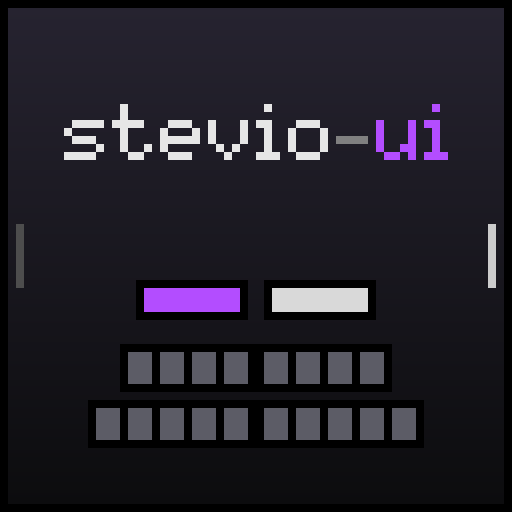

# stevio-ui

A minimalist total-conversion UI for **WoW Forever** (interface 16001).

The goal is to see as much of the game world as possible: everything that
matters sits in one cluster at the bottom centre, everything else stays hidden
until it is needed, and as much as possible can be done from the keyboard.

> **This is an all-or-nothing UI.** On first load it asks for permission to
> overwrite your **keybindings, graphics/interface settings (CVars), action bars
> and Edit Mode layout** account-wide. Your previous settings are backed up first;
> `/sui restore` brings them back and disables the addon. Declining disables the
> addon right away.

## Features

- **Unit frames** – player, target, pet and target-of-target as slim bars with
  own cast bars and combo point segments.
- **Group grid** – up to 40 players; class colours, resource, dispellable debuffs,
  role, range, death, aggro and target highlight.
- **Keyboard healing** – the arrow keys move a cursor over the group grid and set
  your real target, so heals can be cast without a mouse. Works in combat.
- **Quickjump** – two-letter labels on dialogs, gossip, quest windows, flight
  maps and other panels; type the letters to click. Shift on the first letter
  right-clicks.
- **Action bars, menu and bags** – Blizzard's secure buttons, stripped down and
  placed via a dedicated Edit Mode layout named `stevio-ui`.
- **Minimap** – square, borderless, mouse-wheel zoom, size derived from the
  screen.
- **Chat and objective tracker** – hidden by default, toggled by key, with edge
  badges that light up on new whispers, party or guild messages.
- **Quest rewards** – marks the choice with the highest vendor value.
- **Damage meter and auras** – Blizzard's own, repositioned.

## Assumptions

stevio-ui is built for one setup and is configured in code, not through options:

- **German keyboard layout** – Quickjump letters and some keys are chosen for
  it (`Y`/`Z` are swapped compared to US).
- **UI scale around 0.8** (≈ 960 UI units screen height). At higher scales the
  40-player grid overlaps the damage meter.
- **The bundled keybinding and graphics profile is the author's own.** Change
  `Modules/Settings/Profile.lua` (or generate your own with `/sui export`) to make
  it yours.

## Installation

Install from CurseForge, or copy the `stevio-ui` folder into the
`Interface/AddOns/` folder of your WoW Forever client. Accept the dialog on
first login.

## Keys

| Key | Action |
| --- | --- |
| Arrow keys | Move the group grid cursor (sets your target) |
| `,` | Quickjump: show labels / next window |
| `J` / `K` | Quickjump: scroll |
| `.` | Toggle chat |
| `-` | Toggle objective tracker |

## Commands

| Command | Action |
| --- | --- |
| `/sui test 5\|10\|25\|40` | Preview the group grid |
| `/sui qj` | List the current Quickjump targets |
| `/sui export` | Export your current bindings and settings as a profile |
| `/sui apply` | Re-apply the profile |
| `/sui restore` | Restore the settings from before stevio-ui and disable it |

## Configuration

Every module has a `Config.lua` (`enabled = false` turns it off), the global
look lives in `Core/Config.lua` and all positions in `Core/Layout.lua`. Edit and
`/reload`.

## License

[MIT](LICENSE)
