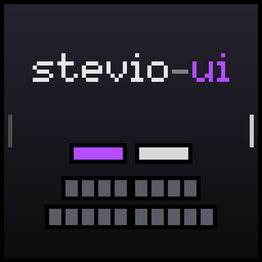

# stevio-ui

A minimalist total-conversion UI for **WoW Forever** (interface 16001)

The goal is to see as much of the game world as possible: everything that
matters sits in one cluster at the bottom centre, everything else stays hidden
until it is needed, and as much as possible can be done from the keyboard.

> **This is an all-or-nothing UI.** On first load it asks for permission to
> overwrite your **keybindings, graphics/interface settings (CVars), action bars
> and Edit Mode layout** account-wide. Your previous settings are backed up first;
> `/sui restore` brings them back and disables the addon. Declining disables the
> addon right away.

## Features

- **Unit frames** – player, target, focus, pet and target-of-target as slim
  bars with health text ("12.3k · 87%"), own cast bars with spell name and
  remaining time (focus has a smaller one), combo point segments and your own
  debuffs on the target in a row above it.
- **Group grid** – up to 40 players; class colours, the name as a faint
  watermark, resource, incoming heals and absorb shields, dispellable debuffs,
  your own HoTs and buffs along the top, role, range, death, aggro and target highlight.
- **Keyboard healing** – the arrow keys move a cursor over the group grid and set
  your real target, so heals can be cast without a mouse. Works in combat.
- **Quickjump** – two-letter labels on dialogs, gossip, quest windows, flight
  maps and other panels; type the letters to click. Shift on the first letter
  right-clicks.
- **Action bars, menu and bags** – Blizzard's secure buttons, stripped down and
  placed via a dedicated Edit Mode layout named `stevio-ui`.
- **Minimap** – square, borderless, mouse-wheel zoom, the looking-for-group
  button in its lower left corner, size derived from the screen.
- **Channel chat and objective tracker** – chat is organised in channels like
  Slack/Teams, with a persistent per-character history and a date line before
  the first message of each day (`dateFormat`):
  - party, raid and instance; guild (with officer chat, Guild Discord and the
    message of the day); one channel per community stream; one per whisper
    partner; say (including emotes such as `/e` and `/dance`), yell and the chat
    channels listed in `publicChannels`, e.g. General and Trade;
  - "Other" collects every other chat channel read-only, each line naming its
    channel before the sender;
  - "NPC" collects NPC and boss speech, "Loot & Progress" loot (also other
    players'), money, currencies, XP, honor, reputation, skill-ups,
    achievements and level-ups, and "System" everything else Blizzard's chat
    shows (players coming online or going offline, AFK replies, channel
    notices, ...) together with addon output: `/sui` replies open that
    channel, other addons' output only counts as unread. These three are read-only and coloured like Blizzard's chat.

  `x` deletes any channel but guild with its history. Say, emotes, yell, chat
  and community channels, NPC, Loot & Progress and System only count as unread and don't pop
  up the chat. Hidden by default, toggled by key, with edge
  badges that light up on new whispers, party or guild messages; it opens on
  the channel with the latest activity. Chat commands, emotes and addon
  commands typed into the channel view's own input run there (`/w Bob hi`,
  `/p hi`, `/dance`, `/sui`, ...); Blizzard's other commands (`/cast`,
  `/target`, `/roll`, `/who`, ...), which only work safely from its own input,
  are handed to that input pre-filled, and Enter runs them.
  Blizzard's chat stays hidden; only its
  input box (Enter, slash commands) is used, shown right under the channel view
  and hidden together with it. Blizzard's chat toasts (e.g. a Battle.net friend
  coming online) pop up right under that input box.
- **Loot ticker** – your last 24 looted items, currencies and gold above the
  bags, with icon, name in quality colour and count; gold is shown with coin
  icons on one line. Other group members' loot from rare quality up
  (`groupMinQuality`) appears as "item  Name" with the name in class colour,
  dimmed and gone sooner. A group loot roll is a single line per drop, read
  from the loot history and updated in place: "rolling · you: Need" until it
  is decided, then the winner with their roll and yours (or "all passed");
  the winner's loot message adds no extra line. Details (count, player,
  roll) sit on the right and are never cut off; only a long item name is
  shortened. New loot enters at the bottom
  and pushes older lines up; when all rows are taken the oldest drops out,
  and every line fades out slowly after a few seconds. Looting more of
  something still listed adds to that line.
- **Quest rewards** – marks the choice with the highest vendor value.
- **Auras** – Blizzard's own, compacted to two rows of buffs and two rows of debuffs in the top right corner, with the objective tracker below them. Blizzard's damage meter is turned
  off (`damageMeterEnabled` in the profile); the loot ticker uses its space at the bottom left.

## Assumptions

stevio-ui is built for one setup; its defaults in code are the author's, and
the options panel (see Configuration) changes them for yours:

- **German keyboard layout** – Quickjump letters and some keys are chosen for
  it (`Y`/`Z` are swapped compared to US).
- **UI scale around 0.8** (≈ 960 UI units screen height). At higher scales the
  40-player grid overlaps the loot ticker at the bottom left.
- **The bundled keybinding and graphics profile is the author's own.** Change
  `Modules/Settings/Profile.lua` (or generate your own with `/sui export`) to make
  it yours.

## Installation

Install from CurseForge, or copy the `stevio-ui` folder into the
`Interface/AddOns/` folder of your WoW Forever client. Accept the dialog on
first login.

## Keys

| Key | Action |
| --- | --- |
| Arrow keys | Move the group grid cursor (sets your target) |
| `,` | Quickjump: show labels / next window |
| `J` / `K` | Quickjump: scroll |
| `.` | Toggle chat |
| *(unbound)* | Chat: write message, next / previous channel (`Tab` / `Shift-Tab` in the input) |
| `-` | Toggle objective tracker |

## Commands

| Command | Action |
| --- | --- |
| `/sui test 5\|10\|25\|40` | Preview the group grid |
| `/sui loot` | Preview the loot ticker with a few items from your bags |
| `/sui chat` | List the chat channels with message and unread counts |
| `/sui qj` | List the current Quickjump targets |
| `/sui notch` | Show the notch geometry (for checking the island's placement) |
| `/sui errors` | Show stevio-ui's logged Lua errors (`/sui errors clear` empties the log) |
| `/sui config` | Open the options panel |
| `/sui reset` | Reset all options to the defaults in code |
| `/sui export` | Export your current bindings and settings as a profile |
| `/sui apply` | Re-apply the profile |
| `/sui restore` | Restore the settings from before stevio-ui and disable it |

## Configuration

The defaults live in code: every module has a `Config.lua` (`enabled = false`
turns it off), the global look lives in `Core/Config.lua`, all positions in
`Core/Layout.lua` and the keybindings and graphics settings in
`Modules/Settings/Profile.lua`.

The options panel (Options → AddOns → stevio-ui, or `/sui config`) changes
them account-wide without touching the code: a page per module generated from
its config (every value, including lists, which can grow and shrink) followed
by the positions it places, a General page with the modules, style and any
remaining positions, and pages for keybindings and graphics settings. Changed values are highlighted and take effect after
`Reload UI`. Keybindings and settings changed in Blizzard's own menus are kept
as well instead of being reverted at the next login. `/sui reset` (or "Reset
all options") goes back to the code.

## Development

`tests/run.sh` runs what CI runs on every push: a syntax check, luacheck,
StyLua's format check and the unit tests in `tests/`. `nix develop` (or direnv)
provides the tools.

## License

[MIT](LICENSE)
