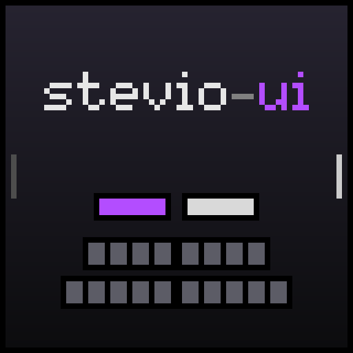

# stevio-ui

A minimalist total-conversion UI for **WoW Forever** (interface 16001)

The goal is to see as much of the game world as possible: everything that
matters sits in one cluster at the bottom centre, everything else stays hidden
until it is needed, and as much as possible can be done from the keyboard.

> **This is an all-or-nothing UI.** On first load it asks for permission to
> overwrite your **keybindings, graphics/interface settings (CVars), action bars
> and Edit Mode layout** account-wide. Your previous settings are backed up first;
> `/sui restore` brings them back and disables the addon. Declining disables the
> addon right away.

## Features

- **Unit frames** – player, target, focus, pet and target-of-target as slim
  bars with health text ("12.3k · 87%"), own cast bars with spell name and
  remaining time (focus has a smaller one), combo point segments and your own
  debuffs on the target in a row above it.
- **Group grid** – up to 40 players; class colours, the name as a faint
  watermark, resource, incoming heals and absorb shields, dispellable debuffs,
  your own HoTs and buffs along the top, role, range, death, aggro and target highlight.
  Left-click a cell to target that player, right-click for their menu.
- **Keyboard healing** – the arrow keys (`keys` in the keyboard healing
  options; they lose their normal binding) move a cursor over the group grid and set
  your real target, so heals can be cast without a mouse. Works in combat.
  While your target isn't friendly, the first press only returns to the
  cursor's player; moving starts with the next one.
  When you target something else (an enemy, loot, nothing), the cursor stays
  on its cell with a thinner, dimmer border.
- **Flight list** – flight masters get a list of the reachable destinations
  next to the map, sorted by name with their cost (none for free flights);
  click one to fly there. A list taller than the map scrolls.
- **Action bars, menu and bags** – Blizzard's secure buttons, stripped down and
  placed via a dedicated Edit Mode layout named `stevio-ui`.
  Two columns of 12 buttons on the right screen edge (bars 4 and 5, no
  keybindings) hold emotes, consumables and the like.
- **Action sets** – switchable sets of actions for the same bars, e.g.
  "Leveling" and "Healing" (`sets` in the action bar options). The button left
  of the bars (left click: next set, right click: previous set; or
  `/sui bars <name>`, or a key) switches all bars and pages at
  once, out of combat only; slots and keybindings stay the same, only the
  spells, items and macros in them change. Leaving a set remembers what its
  bars hold, so a set is edited simply by changing the bars while it is active.
  A set used for the first time starts as a copy of the current bars. Sets are
  stored per character; actions that can't be placed right now (e.g. a talent
  that isn't learned) stay in the set for later. Each switch names them with
  their slot; `/sui bars forget` drops them from the active set (so does putting
  something else in their slot). The two columns on the right edge are left
  alone by every switch (`sharedBars` in the action bar options).
- **Minimap** – square, borderless, mouse-wheel zoom, the looking-for-group
  button in its lower left corner, size derived from the screen. Other
  addons' minimap buttons move into the notch island (the black panel that
  opens when the cursor reaches the top of the screen), in a clickable grid
  below its other rows (`minimapButtons` in the notch options). The mail and
  tracking icons stay on the map, the vehicle leave button sits below it.
  `,` hides the whole lower right corner (the map with its icons, the mark
  toolbar and the micro menu) and shows it again; the choice is kept across
  sessions. The vehicle leave button stays.
- **Notch island** – a black panel that grows out of the notch when the cursor
  reaches the top of the screen (not while mouselooking) and hides again
  shortly after it leaves: level and XP bar with rested XP, the watched
  reputation, gold, free bag slots, lowest durability (yellow/red when low),
  zone with coordinates, time, FPS and latency, online friends and guild
  members, the players and notes buttons and the other addons' minimap buttons.
- **Tooltip** – Blizzard's default tooltip position is moved above the minimap
  and the mark toolbar.
- **Objective tracker** – hidden at login (`shownOnLogin`), toggled with `-`
  or the badge at the right screen edge, placed below the auras.
- **Mark toolbar** – shown on top of the minimap, right aligned,
  with the default tooltip position above it: the eight raid symbols (skull
  first) and a clear button. Left click puts the symbol on the target or
  takes it off again (the target's symbol is outlined; symbols are dimmed
  while there is nothing to mark), left click on clear unmarks the target.
- **Channel chat** – chat is organised in channels like
  Slack/Teams, with a persistent per-character history and a date line before
  the first message of each day (`dateFormat`):
  - "Main" shows party, instance, raid, guild, whispers and emotes together
    (each switchable in `main.channels`, say and yell too), each
    line tagged with its channel (`[Party] Bob: pull`, the name in that
    channel's colour like everywhere, the text white), so there's no
    switching back and forth; the single channels stay too. Its unread count
    is that of its lines and reading it reads them. Typing in Main answers in the channel
    of the latest line (named in the header, `Main > Party`), kept while
    typing; clicking a line's tag writes to that channel instead (`main`);
  - party, raid and instance; guild (with officer chat, Guild Discord and the
    message of the day); one channel per community stream; one per whisper
    partner; "Nearby" with say, yell (in the yell colour) and emotes such as
    `/e` and `/dance`, so a role-play scene reads in one place; writing there
    says, `/y` and `/e` work too;
  - one channel per chat channel, by its full name: zone channels such as
    General and LocalDefense one per zone ("General - Elwynn Forest"),
    Trade and the other channels in `cityChannels` one wherever they are
    joined, and every custom channel its own;
  - "NPC" collects NPC and boss speech, "Loot & Progress" loot (also other
    players'), money, currencies, XP, honor, reputation, skill-ups,
    achievements and level-ups, and "System" everything else Blizzard's chat
    shows (players coming online or going offline, AFK replies, channel
    notices, ...) together with addon output: `/sui` replies open that
    channel, other addons' output only counts as unread. "Notices" keeps
    what other players craft nearby out of System: it never counts as unread
    or opens the chat. These four are read-only and coloured like Blizzard's chat.

  The boxed input line at the bottom of the channel view writes to the shown
  channel; while empty it says where to ("Write to Bob ..."), and while typing
  its border takes that channel's colour. Click it, or use the chat input key,
  to type there; Enter still opens Blizzard's own input box below the view.
  Clicking a player's name in a message opens the whisper channel with them
  and starts typing into it; right click opens a menu to whisper or invite
  them.
  `x` deletes any channel but guild and Main with its history. Nearby, chat
  and community channels, NPC, Loot & Progress and System only count as unread
  unless their lines show in Main. Hidden by default, toggled by key or by the badge at the left
  screen edge, whose three segments light up on new whispers, group (party,
  raid, instance) or guild messages. A new message doesn't pop up the hidden
  chat: it shows for a few seconds as a line of text where the chat sits,
  without a background (up to three, the newest at the bottom; a line under
  the cursor stays, a click opens the chat on its channel; `preview`). Only
  `/sui` replies open the chat, on System, until it hides again; then it goes
  back to the channel shown before, unless you opened the chat or picked a
  channel meanwhile. The open chat's background is see-through and turns
  nearly solid while the cursor is over it or you type (`openAlpha`,
  `activeAlpha`), so it doesn't cover the game like a black block yet reads
  well when you want it. The chat starts on Main and otherwise reopens on the channel
  last shown. Raid warnings and officer chat are marked `[RW]` and
  `[O]`. During boss fights and PvP matches the game hides chat
  from addons: those messages show as "… (readable after the fight)" and
  are filled in once it is over; whispers from then arrive afterwards. The mouse wheel scrolls (`scrollStep`), and the Copy button in the
  header shows the channel as plain text to copy. Chat commands, emotes and addon
  commands typed into the channel view's own input run there (`/w Bob hi`,
  `/p hi`, `/dance`, `/sui`, ...); Blizzard's other commands (`/cast`,
  `/target`, `/roll`, `/who`, ...), which only work safely from its own input,
  are handed to that input pre-filled, and Enter runs them.
  Blizzard's chat stays hidden; only its
  input box (Enter, slash commands) is used, shown right under the channel view
  and hidden together with it. Blizzard's chat toasts (e.g. a Battle.net friend
  coming online) pop up right under that input box.
- **Loot ticker** – your own last 24 looted items, currencies and gold above
  the bags, with icon, name in quality colour and count; gold is shown with
  coin icons on one line. Other players' loot and group loot rolls are not
  listed (rolls have their own cards, see Loot rolls); an item you win shows
  up as your own loot. New loot enters at the bottom and pushes older lines
  up; when all rows are taken the oldest drops out, and every line fades out
  slowly after a few seconds. Looting more of something still listed adds to
  that line. Loot the game hides from addons during a boss fight is listed
  once the fight is over.
- **Loot rolls** – a card for every group loot roll you are offered, below the
  notch (it slides down under the notch island while that is open), in place
  of Blizzard's Need/Greed/Pass popup: icon, name in quality colour with a
  stripe of that colour on the left, a timer bar and three buttons, Need ·
  Greed (or Transmog, when the item allows it) · Pass. A choice the game
  doesn't allow is greyed out, its reason shows on hover. Several drops stack
  up, rolls still to answer on top. Once you rolled, the card shrinks to the
  result: the winner ("You win" in green) and the three best rolls plus
  yours, filled in from the loot history; after a pass it is dimmed. It fades
  out 15 seconds after the winner is known (not while the cursor is on it);
  ✕ closes it earlier. Hover shows the item, shift-click links it. The dice
  button in the notch island opens the roll history in the loot ticker's
  place: every decided roll, newest first, under a header per boss
  (boss · instance · date); a click on a drop lists everyone's choice and
  number. It has a search (item, boss or player), a "Mine" filter (drops you
  rolled on or won) and a Clear button; the history is kept per character.
  `replaceBlizzardRolls = false` brings Blizzard's popup back (after
  `/reload`); the cards then appear once you rolled there.
- **Quest rewards** – on the turn-in page with at least two item choices,
  a gold coin marks the one with the highest vendor value (sell price × count).
- **Players** – a player database (button in the notch island, or
  `/sui players`): everyone you group with is recorded, one session per time
  together with the date, the role, the place (the instances entered, or else
  the open-world zone) and the bosses killed and wipes. Rate each session with
  1–5 stars, change its role, add a comment, and keep one note per player; the
  list and the player's tooltip show the average of the rated sessions,
  overall and per role. Each player's page also shows the groups and time
  together, the items they won in your groups (from the roll history, also
  per session) and how often they chose Need, Greed or Pass; the tooltip shows
  the loot line too (`lootInTooltip`). After leaving a group a small popup
  offers to rate its players ("Later" closes it), and a rated or noted player
  joining your group gets a chat line. "Player info" in the chat's name menu
  opens a player. Players without a rating or note are deleted after 90 days
  (`keepUnratedDays`); rated ones stay.
  *Blocked guilds* (`blockedGuilds`, Lua patterns in the Players options):
  players seen in such a guild are marked in the players list for good, also
  after they leave it, with a red warning when first seen, when they join your
  group and under each of their whispers, naming the guild and the pattern.
  Account-wide.
- **Notes** – a window (button in the notch island, or `/sui notes`) with two
  tabs. *Items*: free text per item type, shown in its tooltip; Alt+right-click an
  item in your bags or bank (or drop it on the list) to write or remove it.
  *Notes*: plain notes. All notes are account-wide.
- **Auras** – Blizzard's own, compacted to two rows of buffs and two rows of debuffs in the top right corner, with the objective tracker below them. Blizzard's damage meter is turned
  off (`damageMeterEnabled` in the profile); the loot ticker uses its space at the bottom left.

## Assumptions

stevio-ui is built for one setup; its defaults in code are the author's, and
the options panel (see Configuration) changes them for yours:

- **German keyboard layout** – some keys are chosen for it (`Y`/`Z` are
  swapped compared to US).
- **UI scale around 0.8** (≈ 960 UI units screen height). At higher scales the
  40-player grid overlaps the loot ticker at the bottom left.
- **The bundled keybinding and graphics profile is the author's own.** Change
  `Modules/Settings/Profile.lua` (or generate your own with `/sui export`) to make
  it yours.

## Installation

Install from CurseForge, or copy the `stevio-ui` folder into the
`Interface/AddOns/` folder of your WoW Forever client. Accept the dialog on
first login.

## Keys

| Key | Action |
| --- | --- |
| Arrow keys | Move the group grid cursor (sets your target) |
| `.` | Toggle chat |
| *(unbound)* | Chat: write message, next / previous channel (`Tab` / `Shift-Tab` in the input) |
| `-` | Toggle objective tracker |
| `,` | Toggle the lower right corner (minimap, mark toolbar, micro menu) |
| `F12` | Game console (`consoleKey` in the settings options) |
| *(unbound)* | Next action set |

## Commands

| Command | Action |
| --- | --- |
| `/sui test 1-40` | Preview the group grid with that many players (e.g. 5, 10, 25, 40); `/sui test` alone turns it off |
| `/sui loot` | Preview the loot ticker with a few items from your bags |
| `/sui rolls` | Preview two roll cards (with an item from your bags) and the roll history with made-up entries |
| `/sui bars [name\|number\|next]` | List the action sets or switch to one |
| `/sui bars missing` | List the actions the active set could not place |
| `/sui bars forget` | Drop those actions from the active set |
| `/sui players [name]` | Toggle the players window, or open that player |
| `/sui notes [item link]` | Toggle the notes window, or edit the note of that item |
| `/sui chat` | List the chat channels with message and unread counts |
| `/sui notch` | Show the notch geometry (for checking the island's placement) |
| `/sui errors` | Show stevio-ui's logged Lua errors, kept across sessions (`/sui errors clear` empties the log) |
| `/sui config` | Open the options panel |
| `/sui reset` | Reset all options to the defaults in code |
| `/sui export` | Export your current bindings and settings as a profile (also saved to `StevioUIExport` in the WTF folder) |
| `/sui apply` | Re-apply the profile |
| `/sui restore` | Restore the settings from before stevio-ui and disable it |

`/sui` alone lists all commands. `config`, `reset`, `export`, `apply` and
`restore` only exist once you have accepted the first-login dialog. `test`,
`loot`, `rolls`, `qj` and `notch` say so when their module is turned off.

## Configuration

The defaults live in code: every module has a `Config.lua` (`enabled = false`
turns it off), the global look lives in `Core/Config.lua`, all positions in
`Core/Layout.lua` (including which action bars are styled and placed: each
entry of `actionBars` names its Edit Mode bar) and the keybindings and graphics settings in
`Modules/Settings/Profile.lua`.

The options panel (Options → AddOns → stevio-ui, or `/sui config`) changes
them account-wide without touching the code: a page per module generated from
its config (every value, including lists, which can grow and shrink) followed
by the positions it places, a General page with the modules, style and any
remaining positions, and pages for keybindings and graphics settings. Changed values are highlighted and take effect after
`Reload UI`. Keybindings and settings changed in Blizzard's own menus are kept
as well instead of being reverted at the next login. `/sui reset` (or "Reset
all options") goes back to the code.

## Development

`tests/run.sh` runs what CI runs on every push: a syntax check, luacheck,
StyLua's format check and the unit tests in `tests/`. `nix develop` (or direnv)
provides the tools.

## License

[MIT](LICENSE)
